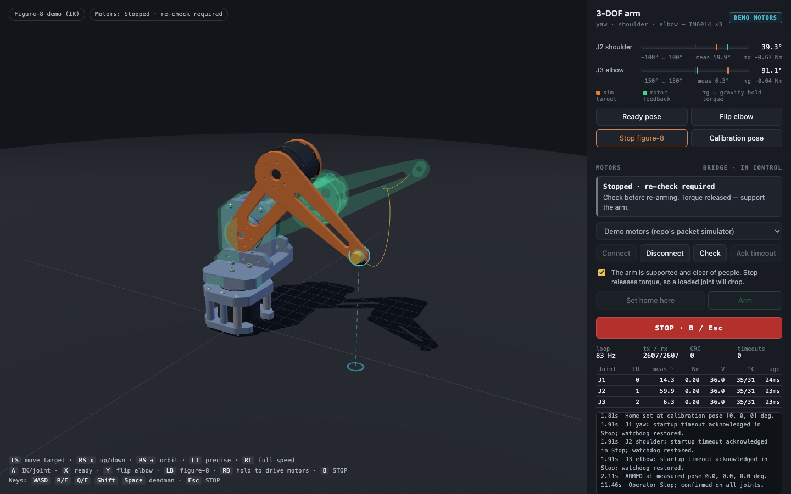

# 3-DOF arm simulator · IK · Xbox control · IM6014 bridge

A browser simulation of a yaw–shoulder–elbow arm built from the `mainAssem.stl` CAD. It has analytic
inverse kinematics and Xbox controller input. A Python bridge streams the joint targets to three Unitree IM6014
actuators using the packet code from
[sidrk-dev/im6014Development](https://github.com/sidrk-dev/im6014Development).


```
Xbox pad ─► browser sim (three.js, IK, collision checks) ─► WebSocket ─► bridge/arm_bridge.py
                                                                          │  im6014Development:
                                                                          │  command / exchange / healthy
                                                                          ▼
                                                        RS-485 ─► IM6014 IDs 0, 1, 2   (or the repo's DemoSerial)
```

## Run it

```bash
./setup.sh                              # clones im6014Development, makes .venv with pyserial
.venv/bin/python bridge/arm_bridge.py   # serves the sim + bridge on http://127.0.0.1:8765
```

Open <http://127.0.0.1:8765>. The motors stay disconnected until you connect them in the page.
For the simulation alone, any static server works (`python3 -m http.server`, then open `/web/`).
Without the bridge, the Motors panel shows "offline".

**Xbox controller:** pair it over Bluetooth, then press any button while the page is open, because browsers
only expose a gamepad after a press. Keep the sim tab visible. A hidden tab throttles timers, and the bridge treats
that as a lost heartbeat and stops the motors.

| Input | IK mode (default) | Joint mode |
|---|---|---|
| Left stick | Move the target across the floor, relative to the camera | J1 ↔, J2 ↕ |
| Right stick | ↕ raise/lower the target, ↔ orbit the camera | J3 ↕ |
| LT / RT | Precision (¼ speed) / full speed | same |
| A | Toggle IK ↔ joint | |
| X / Y | Go to ready pose / flip the elbow | |
| LB | Start/stop the figure-8 demo path | |
| **RB (hold)** | **Deadman: armed motors follow the sim only while held** | |
| **B** | **STOP: all motors to Stop, disarm (torque off)** | |
| Menu ☰ | Check, then arm (needs the "supported" box ticked) | |
| View ⧉ / D-pad ↕ | Reset camera / speed ± | |

Keyboard equivalents: WASD, R/F, Q/E, Shift (precision), Space (deadman), M, H, G, P, C, and Esc (STOP).

## How the CAD was interpreted

The STL is a single unnamed mesh. `tools/split_assembly.py` splits it into parts by edge-connectivity and
assigns them to links. **CAD −Z is up**, and the brown end plate is the mounting face on the table.

| Joint | Motor (CAD colour in the source render) | Axis | Notes |
|---|---|---|---|
| J1 yaw | blue, in the base cage | vertical | The L-bracket bolts to its output on a 3-bolt, r = 17 mm circle |
| J2 shoulder | red, carried by the L-bracket | horizontal | Ø54.6 output flange; axis 137.2 mm above the table, intersecting the yaw axis |
| J3 elbow | orange, not yet mated in CAD | parallel to J2 | Re-posed at the elbow; stator on the upper arm, output toward the forearm |

The upper arm and forearm do not exist in the CAD yet. They are **assumed** 6 mm parametric plates,
150 mm each (`config/arm.json → geometry`), drawn in orange so they read as placeholders.

Because the elbow motor sits between the two plates, the tool is offset 54.4 mm sideways from the yaw
axis, and the IK accounts for that offset. One loose nut floating outside every bracket is dropped.

**The IK is closed-form.** Each target has up to four solutions: reach in front of or behind the yaw axis, crossed with elbow up or down.
The solver keeps the valid solution nearest the current pose. It rejects poses past a joint limit, into the floor,
or into the turret.

A blocked move slides along the boundary rather than stopping, and Cartesian steps are scaled down so no
joint exceeds its `max_speed_dps`. That makes the sim a faithful preview of how the motors will move.

One geometric finding: two L-bracket pillars rise to 108 mm, just under the 137 mm shoulder axis. As
modelled, the upper arm can only swing to about ±90° (horizontal) over the turret.

## Driving motors

The bridge imports `spin_5rpm.command / exchange / healthy` and `motor_session.DemoSerial / fault_text`
from im6014Development unchanged (tested at commit `69c8219`). It adds what that single-motor bench app
leaves to "separate integration":

- several motor IDs
- a per-session joint zero
- joint limits
- rate-limited continuous position streaming (Kp/Kd with velocity feed-forward)
- an operator deadman

It keeps the bench app's conventions:

- It starts disconnected and disarmed, and only sends Stop/status until armed.
- Every FOC packet sets the firmware watchdog.
- Faults latch disarmed, and nothing resumes on its own.

Flow in the Motors panel:

1. Pick **Demo motors** (the repo's packet simulator) or **Real IM6014 motors** with a port, then **Connect**.
2. If any joint reports a startup timeout, support the arm and click **Ack timeout**.
3. Physically pose the arm at `calibration_pose_deg` (default: both links straight up, turret facing +x), tick
   *supported*, and click **Set home here**. Multi-turn position does not survive a power cycle, so this
   is done every session. Demo motors start at home.
4. **Arm** (or ☰). The motors hold the measured pose, and the sim jumps to it.
5. **Hold RB** to make the motors follow the sim. Release RB and they hold while the sim previews ahead.
6. **B / Esc / STOP** stops every joint and disarms. Re-arming needs **Check** first.

The bridge also stops and disarms on any of these:

- browser heartbeat older than 0.5 s, or the controlling tab closing
- motor feedback older than 0.1 s
- any fault, warning, voltage or temperature flag from `healthy()`
- measured torque over 4 Nm
- a joint more than 5° past its limit
- tracking error over 30°

Only one tab controls the arm; any tab can STOP. The bridge binds to 127.0.0.1 and rejects other
Host/Origin headers, so a web page cannot connect to it and command the arm.

> **Stop releases torque — a gravity-loaded arm falls.** Support the arm whenever you stop it. This is
> not a safety-rated controller. Keep motor power isolation within reach.

### Before real hardware

- **IDs and wiring.** The default is IDs 0/1/2 on one RS-485 channel at 6 Mbps. The FTDI path in
  `config/arm.json` is the Linux by-id path from the repo's bench test. On macOS, look for
  `/dev/cu.usbserial-*` (`bridge/arm_bridge.py --list-ports`). A joint can set its own `"port"` to use
  another FT4232H channel. The repo does not assign IDs; its dashboard's *Discover IDs* scan is a good
  check. The repo's hardware path was validated on Linux; 6 Mbps through macOS's FTDI driver is untested here.
- **Direction signs.** Jog each joint a few degrees and flip `direction` where the motor moves opposite
  to the sim.
- **Gravity sag.** With the repo's starting gains (Kp 3, Kd 1), a horizontal arm needs about 1.04 Nm at J2
  (IM6014 = 535 g at the elbow), so it sags about τ/Kp ≈ 20°. The panel shows τg per joint. Either raise Kp
  (≤ 30), or set real masses in `geometry.mass_kg`, confirm the direction signs, and turn on
  `safety.gravity_ff`. Gravity feed-forward is capped by `torque_ff_limit_nm`.

## Files

```
config/arm.json            link lengths, masses, joint IDs/limits/gains/speeds, safety limits (shared)
web/index.html, web/js/    three.js sim: kinematics.js (FK/IK/collision), gamepad.js, orbit.js, bridge.js, main.js
web/meshes/                CAD split per link and material (float32 xyz + uint32 index) + manifest.json
bridge/arm_bridge.py       HTTP + WebSocket server (stdlib), one controlling page, origin checks
bridge/arm_session.py      multi-joint serial-owner thread built on the im6014Development codec
tools/split_assembly.py    re-run after a CAD change: python3 tools/split_assembly.py path/to/mainAssem.stl
tests/                     test_kinematics.mjs (node), test_bridge.py (DemoSerial), test_ui.py (Playwright)
```

## Tests

```bash
node tests/test_kinematics.mjs   # FK/IK round trip over ~3000 poses, speed limits, floor sliding, gravity sign
python3 tests/test_bridge.py     # arm/hold/deadman/limits/heartbeat/tracking trips + WebSocket origin rules
python3 tests/test_ui.py         # optional: headless Chromium + stubbed Xbox pad + demo motors, end to end
```

None of them open a serial port. Nothing here has been run against physical IM6014 motors.


