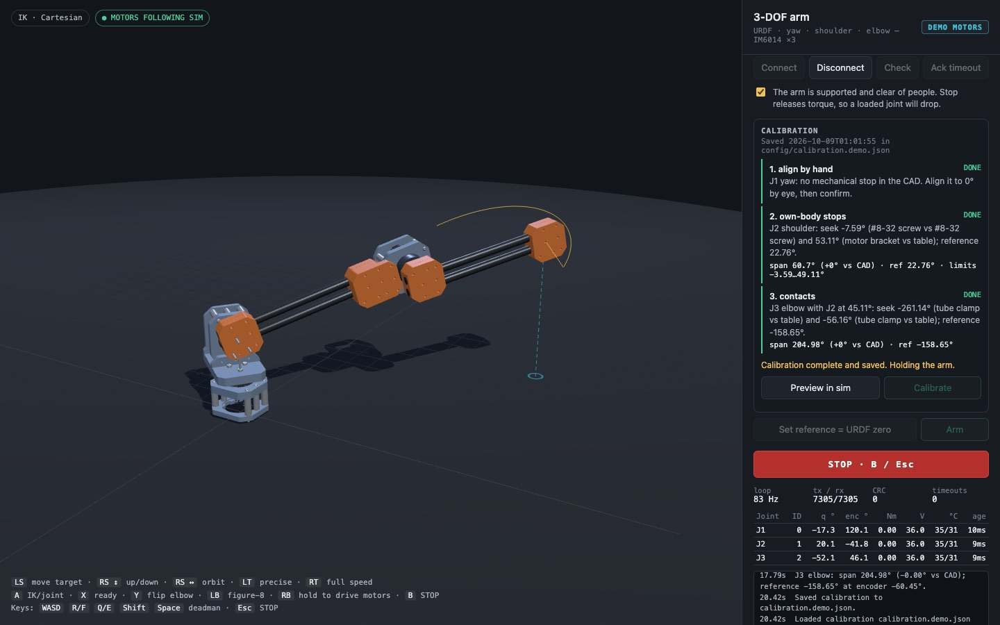
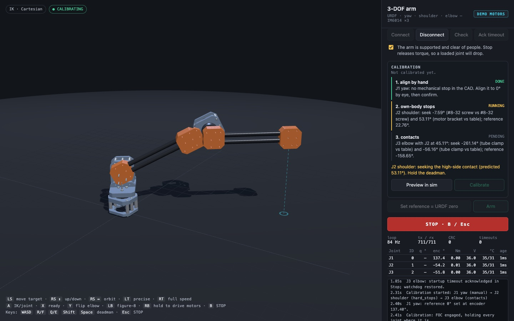

# 3-DOF arm simulator · IK · Xbox control · IM6014 bridge · auto-calibration

A browser simulation of the yaw–shoulder–elbow arm from its Onshape URDF export, with closed-form
inverse kinematics and Xbox controller input. A Python bridge streams joint targets to three Unitree
IM6014 actuators using the packet code from
[sidrk-dev/im6014Development](https://github.com/sidrk-dev/im6014Development), and calibrates
the joints' absolute output encoders against contacts predicted from the CAD.



```
Xbox pad ─► browser sim (three.js, URDF meshes, IK, collisions) ─► WebSocket ─► bridge/arm_bridge.py
                                                                                 │ im6014Development:
                                                                                 │ command / exchange / healthy
                                                                                 ▼
                                                               RS-485 ─► IM6014 IDs 0, 1, 2  (or demo motors)
```

## Run it

```bash
./setup.sh                              # clones im6014Development, makes .venv with pyserial
.venv/bin/python bridge/arm_bridge.py   # serves the sim + bridge on http://127.0.0.1:8765
```

Open <http://127.0.0.1:8765>. The motors stay disconnected until you connect them in the page.
For the simulation alone, any static server works (`python3 -m http.server`, then open `/web/`).

**Xbox controller:** pair it over Bluetooth, then press any button while the page is open, because browsers
only expose a gamepad after a press. Keep the sim tab visible. A hidden tab throttles timers, and the bridge treats
that as a lost heartbeat and stops the motors.

| Input | IK mode (default) | Joint mode |
|---|---|---|
| Left stick | Move the target across the floor, relative to the camera | J1 ↔, J2 ↕ |
| Right stick | ↕ raise/lower the target, ↔ orbit the camera | J3 ↕ |
| LT / RT | Precision (¼ speed) / full speed | same |
| A · X · Y · LB | IK ↔ joint · ready pose · flip elbow · figure-8 demo | |
| **RB (hold)** | **Deadman: armed motors follow the sim, and calibration moves, only while held** | |
| **B** | **STOP: all motors to Stop, disarm (torque off)** | |
| Menu ☰ | Check, arm, or confirm a manual calibration step | |
| View ⧉ / D-pad ↕ | Reset camera / speed ± | |

Keyboard equivalents: WASD, R/F, Q/E, Shift, Space (deadman), M, H, G, P, C, and Esc (STOP).

## The model (from `mainAssem.zip`)

`tools/import_urdf.py` reads the Onshape URDF and glTF meshes, then writes the per-body meshes and
`web/meshes/manifest.json`. Re-run it after any CAD change:

```bash
pip install -r tools/requirements.txt
python3 tools/import_urdf.py ~/Downloads/mainAssem.zip
```

- **Joints:** J1 yaw = `revolute_2`, J2 shoulder = `revolute_1`, J3 elbow = `revolute_3`. Every
  angle in the sim, config, bridge and calibration file is the **URDF joint angle**, so it matches
  RViz.
- **Up direction:** CAD −Z is up. The world origin is on the J1 axis at the lowest point of the base,
  which is the table.
- **`revolute_4` is welded at its CAD angle.** Onshape left a free revolute between the J3 output hub
  and the forearm clamp. It is parallel to J3, 17 mm off-axis, and has no actuator, so as a joint it
  would only let the forearm flop. Change it to a fastened mate in Onshape.
- **Dropped visuals:** `none_2`, a duplicate J1 motor body, and a loose 1/4-20 nut mated to the
  origin. That nut is the same stray part that was in the STL.
- **Closed-form IK:** J1 vertical, J2 ∥ J3 horizontal and intersecting J1, so h = 137.2 mm,
  L2 = 350.5 mm, L3 = 268.8 mm (to the end-clamp centre), and the tool sits −58.1 mm sideways.
  The importer checks the closed form against the URDF chain to within 0.1 mm. That small gap is
  export rounding: J2 misses J1 by about 0.05 mm.
- **Rendering and collisions:** rendering uses the URDF chain itself (product of exponentials on
  the exported axes). The IK rejects poses past joint limits, into the table, or with the forearm
  or upper arm into the turret or base, using CAD-derived sphere sets.
- **Inertials:** the URDF's inertials are placeholders (about 0.1 g per part), so the gravity model
  uses `geometry.mass_kg` in the config.

## Calibration (absolute output encoders)

With an absolute output encoder there is no homing. Each joint stores one reference, and every
reading maps to the URDF angle with

```
q = q_ref + direction · wrap±180°(enc − enc_ref)
```

This is unambiguous whether the IM6014 reports a single-turn or multi-turn absolute angle at
power-up, as long as the joint travels less than 360°. The result is saved once in
`config/calibration.json`. On every connect the bridge maps the current readings and is
immediately calibrated. If a joint reads outside its calibrated range, the bridge says so and won't
arm.

### How the reference angle is found

The importer sweeps each joint through the CAD and records the first angle at which anything touches.
That covers the arm's own parts, the turret, the base, and the table plane. Parts already touching at
the zero pose are treated as joint interfaces and excluded.

At a physical contact the joint angle equals that CAD-predicted angle. The routine seeks the contact
on each side and takes the midpoint:

- **enc_ref** = midpoint of the two measured encoder angles.
- **q_ref** = midpoint of the two predicted angles.

The measured span must match the CAD span (default ±4°). A mismatch fails safely: the motors stop,
disarm, and nothing is saved. That catches a wrong motor ID or direction, a false stall, or a build
that differs from the CAD.

Contact detection does not use a torque threshold, which gravity would fool. The position target
ramps at 10°/s. A contact is declared when the measured speed stays under 30% of the commanded speed
for 0.2 s while the target leads by at least 2°. The joint then backs off 4°. The CAD-derived plan
is listed in the panel, and **Preview in sim** animates it.

| Step | Joint | What the CAD says | Method |
|---|---|---|---|
| 1 | J1 yaw | **No mechanical stop** (the only "stop" was the stray nut) | Align the turret to 0° by eye, then confirm (☰) |
| 2 | J2 shoulder | −7.59°: a #8-32 screw head from the J1 flange hits a shoulder-flange screw. +53.11°: the elbow motor cage touches the table | Seek both; reference 22.76°; limits = measured stops − 4° |
| 3 | J3 elbow | No stop against the arm in 360°. With J2 parked at 45.1°, the end clamp touches the table at −261.14° and −56.16° | Seek both; reference −158.65° |

Start pose (also shown in the sim under *Calibration start pose*): J2 about 23°, with the forearm folded
up at J3 ≈ −150°. From there the J2 sweep is stopped only by the upper arm's own parts, wherever the
forearm sits within ±25° of the start pose.

To run it:

1. **Connect.** If a startup timeout is latched, click **Ack timeout**.
2. **Pose by hand.** Support the arm in the start pose and tick *supported*.
3. **Calibrate.** Align the turret to 0° and press ☰ (or click **Confirm aligned**).
4. **Hold RB.** J2, then J3, seek their contacts. Releasing RB pauses and holds. B stops everything.
5. **Done.** When it finishes, the result is saved and the arm holds its pose. Release RB, then hold it
   again to drive.

**Fallback:** if you'd rather skip the contacts, put the arm physically at the URDF zero pose and click
**Set reference = URDF zero**.

### Findings from the CAD

- **J2 has about 61° of usable travel on a table.** That is −7.6° to +53.1°: the upper arm stays
  44° to 104° forward of vertical. The back stop is the screw-on-screw contact. A shorter screw at
  the J1 flange would free it, until the upper arm meets the turret at +79.3° on the other side.
  After a change like that, re-run the importer: the plan and limits update.
- **J2 torque is close to the bench trip.** With the arm straight out, J2 needs about 3.96 Nm to hold
  (estimated masses), and the ready pose about 3.5 Nm. im6014Development's `healthy()` trips at a
  measured |torque| > 4 Nm. That is a bench-test limit, not the IM6014's 34 Nm peak. Expect trips
  near horizontal or with a payload until you raise that limit deliberately.
- **Gains are raised for the longer links** (J2 Kp 15). Turn on `safety.gravity_ff` once the masses and
  direction signs are confirmed.

## Driving motors (as before)

- **Codec reuse:** the bridge imports `spin_5rpm.command / exchange / healthy` and
  `motor_session.DemoSerial / fault_text` unchanged, tested at commit `69c8219`.
- **Start-up:** it starts disconnected and disarmed, and sends only Stop/status until armed.
- **Watchdog:** every FOC packet sets the firmware watchdog.
- **Trips:** these stop and disarm everything:
  - browser heartbeat older than 0.5 s, or the controlling tab closing
  - motor feedback older than 0.1 s
  - any `healthy()` fault
  - a joint more than 5° past its limit
  - a tracking error over 30°
- **Arming:** after any arm, RB must be released and pressed again before the motors follow the sim.
- **Access:** only one tab controls the arm; any tab can STOP. The bridge binds to 127.0.0.1 and
  rejects foreign Host/Origin headers.

**Demo motors** are the repo's `DemoSerial` with an absolute encoder per joint (a fixed hidden
mounting offset) and the CAD contacts as physical stops. The whole calibration runs without hardware;
the demo result goes to `config/calibration.demo.json`.

> **Stop releases torque — a gravity-loaded arm falls.** Support it whenever you stop. This is not a
> safety-rated controller. Nothing here has been run on physical IM6014 motors.

Before real hardware:
- **IDs and port:** set the motor IDs (0/1/2) and the port. On macOS look for `/dev/cu.usbserial-*`
  (run `--list-ports`).
- **Directions:** jog each joint to confirm its `direction`. A wrong sign shows up as a span "in the
  wrong order" during calibration.
- **Table height:** J2's +53.11° and both J3 contacts are table touches, so they assume the table is
  flush with the bottom of the base. Mount the base on a spacer and those predictions move; rerun the
  importer with `--table-offset-mm`.

## Files

```
config/arm.json            joints (URDF names, IDs, limits, gains), masses, calibration + safety settings
config/calibration.json    written by Calibrate (absolute-encoder references); not created until you run it
web/                       three.js sim: kinematics.js (closed-form FK/IK, sphere collisions), main.js, …
web/meshes/                per-body meshes + manifest.json (joints, IK params, CAD stops, calibration plan)
bridge/arm_bridge.py       HTTP + WebSocket server (stdlib), origin checks, one controlling page
bridge/arm_session.py      serial-owner thread: arming, streaming, calibration state machine
bridge/calibration.py      encoder mapping, contact-seek detector, two-contact solver (pure logic)
bridge/demo_motors.py      DemoSerial + absolute encoders + CAD stops, for offline runs
tools/import_urdf.py       URDF → meshes, kinematics, CAD contact sweeps, calibration plan
tests/                     test_kinematics.mjs, test_bridge.py, test_calibration.py, test_ui.py (Playwright)
```

```bash
node tests/test_kinematics.mjs     # closed form vs URDF chain, IK round trips, limits, table sliding
python3 tests/test_bridge.py       # arming, deadman, trips, WebSocket rules (demo motors)
python3 tests/test_calibration.py  # mapping math; full demo calibration; reconnect; span-mismatch failure
python3 tests/test_ui.py           # optional: headless Chromium + stubbed Xbox pad, calibrate and drive
```


